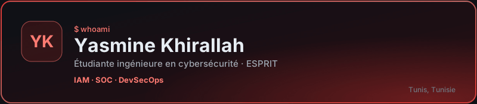

<p align="center">
  
</p>
<p align="center">
  <a href="https://github.com/khirallahyasmin-cyber/cybersecops-platform">
    
  </a>
</p>
### `> whoami`
 
Je m'intéresse à la **sécurité intégrée au cycle de développement** : je construis des pipelines CI/CD qui testent, analysent et sécurisent une application avant même son déploiement.
 
> *La sécurité n'est pas une étape de fin de projet, c'est une partie du pipeline.*
 
---
 
### `> cat skills.txt`
 
```bash
skills --dev       Java 17 · Spring Boot · Maven · MySQL · Nginx
skills --devops    Docker · Docker Compose · Jenkins · Nexus
skills --security  Gitleaks · SonarQube (SAST) · Trivy (SCA/IaC) · OWASP ZAP (DAST)
skills --monitor   Prometheus · Grafana · Spring Boot Actuator
skills --quality   JUnit · JaCoCo · pre-commit · Commitizen · STRIDE
```
 
---
 
### `> contact --help`
 
| | |
|---|---|
| ⭐ **Star a repository** | si un projet vous a été utile |
| 🐛 **Open an issue** | si vous repérez une erreur ou une amélioration |
| 🤝 **Get in touch** | pour échanger ou collaborer sur un projet DevSecOps |
 
<p align="center"><sub>Built with Docker, Jenkins and a lot of scans 🔐</sub></p>
 
