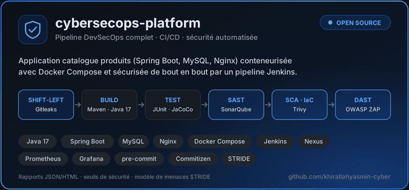

<p align="center">
  
</p>


### `> whoami`

Étudiante ingénieure en cybersécurité, je conçois et j'automatise des solutions d'**IAM**, de **SOC** et de **DevSecOps**.

---

### `> cat skills.txt`

```bash
skills --iam       Active Directory · midPoint · Keycloak · SAML 2.0 · MFA
skills --soc       Wazuh · Threat Intelligence · n8n · Incident Response
skills --devsecops Jenkins · Docker · SonarQube · Trivy · OWASP ZAP
skills --automate  Ansible · PowerShell · Python · Git
skills --dev       Java (Spring Boot) · Django · Symfony
```

---
<p align="center">
  <a href="https://github.com/khirallahyasmin-cyber/cybersecops-platform">
    
  </a>
</p>
### `> contact --help`

[](https://www.linkedin.com/in/khirallah-yasmine-7b206938b)
